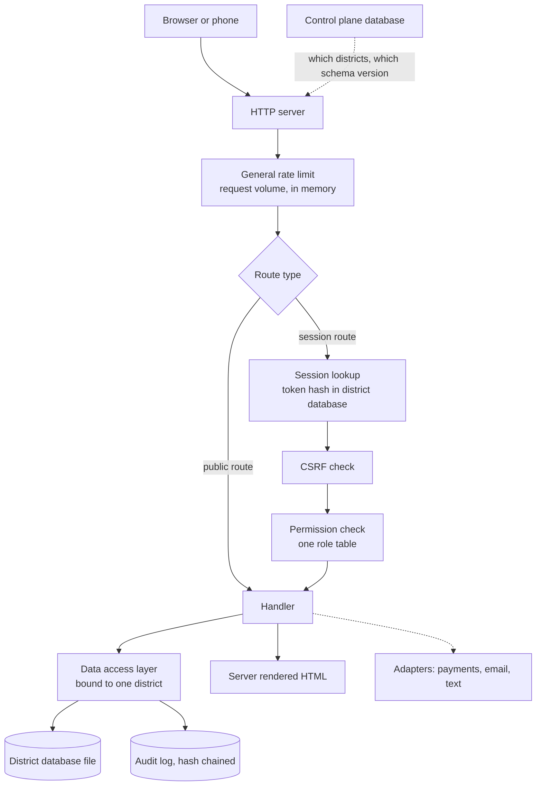

# Architecture

This page describes how ARK is put together. It was written from the private source on 2026-11-24. Nothing here required running the application.

## Shape of the system

One server process written in TypeScript. It runs on Node using Node's built-in type stripping, so there is no compile step. It uses the standard library HTTP server and a router of about 440 lines of its own. It has no runtime npm dependencies. Pages are rendered on the server as HTML. A small amount of plain JavaScript runs in the browser for form behavior. There is no client framework and no build step.

The data layer is SQLite through Node's built-in `node:sqlite` module. Each district has its own database file. A separate control-plane file records which districts exist.

## The request path

In words. A request first passes a general rate limiter that counts raw request volume before the server does any other work. Routes registered as public skip session and CSRF checks. This is a deliberate, narrow path used for things like sign-in pages and webhooks, and the router file documents that it is the one place a mistake would matter. Every other route resolves a session, checks a CSRF token, and calls one permission function with the signed-in person's role, the resource and the action. Only then does the handler run. Handlers do not open databases directly. They call a data access layer whose functions take a context object naming the district, so a query cannot be written without one. State-changing handlers write an audit entry. The handler returns server-rendered HTML.

Reports and exports that scan many rows run on a worker thread against a read-only query, so check-ins on the main thread keep moving.

## One database file per district

Each district's data lives in its own SQLite file. No table ever holds two districts' rows. The reasons are practical.

- Isolation does not depend on every query remembering a `WHERE district = ?` clause. A bug in a query cannot reach another district's file.
- Medical fields are encrypted under a key that is specific to the district, so a copied file or backup of one district opens nothing of another's.
- Moving, exporting, restoring or deleting one district is a file operation.
- At the current scale SQLite in write-ahead mode on one machine is enough, and a single small server runs the whole system.

The cost is that fleet-wide work, such as a schema change, must visit every file. The control plane exists for that.

## The control plane

A separate database, the fleet database, records districts, their schema versions, feature flags, key material references and approval records. Command line operations built on it provision a new district, migrate all districts, and export one district's data. Fleet-wide actions are written as runbooks with approval records instead of being buttons in the application. Per-district settings, such as which ministry modules are on, are rows in data, not code branches.

## Forward-only migrations

Schema changes are numbered versions in one file. There are 122. Each is written to be safe to run twice, and each runs once per district database, in order. There are no down migrations. A mistake is fixed with a later version. The migrate-all operation supports a dry run, runs a canary district first, stops at the first failure, and requires a single-use approval token tied to the exact set of districts and target version. Each district's schema version is recorded in the control plane. A failure therefore stops at one district instead of reaching all of them.

## Server-rendered pages

Every screen is HTML produced on the server from one shared layout function. The consequences are a small attack surface in the browser, a strict Content-Security-Policy, pages that work on a low-end phone, and a user manual that can be generated by fetching the real page as a given role. The cost is that rich interactivity is limited to what plain forms and a little JavaScript can do.

## Zero runtime dependencies

The `package.json` lists no runtime dependencies. Password hashing, encryption, hashing, authenticator codes, the router, the migration runner and the Stripe client use the Node standard library and `fetch`. Two small QR code libraries, an encoder and a decoder, are vendored as source files because a hand-written encoder was found to produce invalid codes. The development dependencies are the TypeScript compiler and Node's type definitions. The reasoning is supply chain exposure: for a system that holds children's records, fewer third-party packages means fewer places to be compromised.

## Adapters for payments, email and text

External services sit behind narrow interfaces so the core does not depend on any of them.

- **Payments.** A small client calls Stripe's HTTP API with `fetch`. Checkout is Stripe's hosted page, so card numbers never reach the server. Payments are off unless keys are configured. A refund splitting module and a fee module compute the labeled lines shown to the payer.
- **Email.** One sender interface with two providers selectable by configuration. Sign-in links, codes, receipts and notices go through it. A development outbox replaces it in tests.
- **Text messages.** One provider-agnostic interface, off unless configured. The adapter in the source drives a self-run Android gateway. Where text is off or fails, the notice goes by email.
- **Key management.** Master keys come from the environment by default. A key provider interface has a second implementation that calls AWS Key Management Service over its HTTP API with request signing written in the codebase. Which one a deployment uses is configuration.

## Backups

The repository holds a configuration for continuous replication of every database file to object storage, a script that copies backups off the machine, and a restore drill script that opens each backup read-only, runs an integrity check and compares row counts. The architecture decision record on backups states the rule that a backup nobody has restored is not a backup. Whether the drill runs on a schedule in production is not claimed here.
